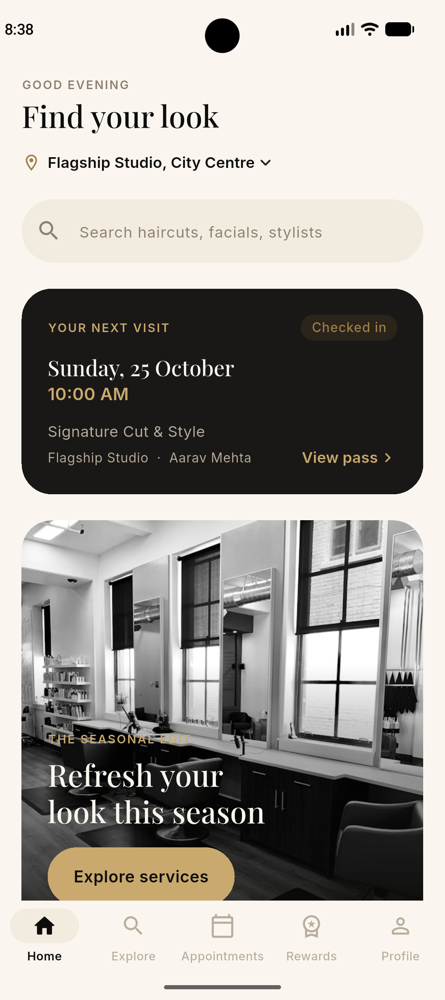
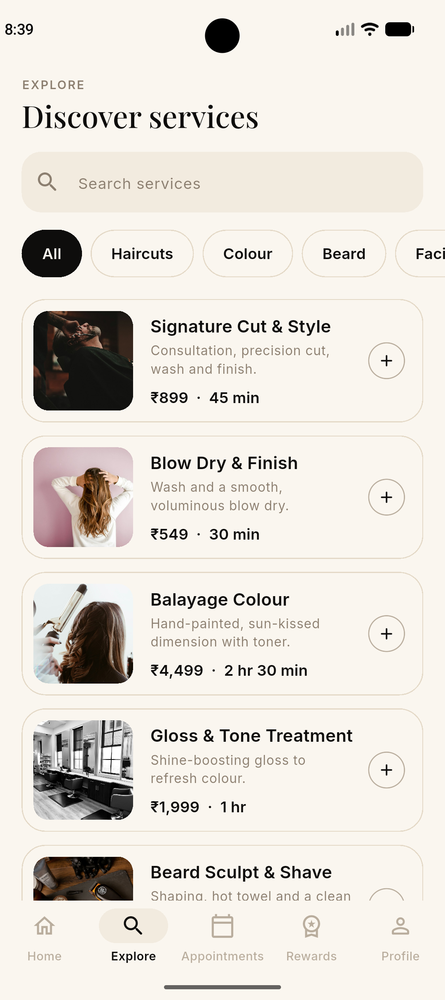
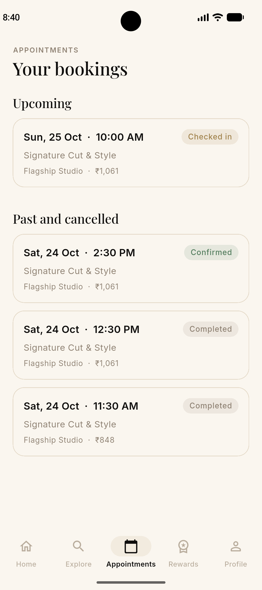
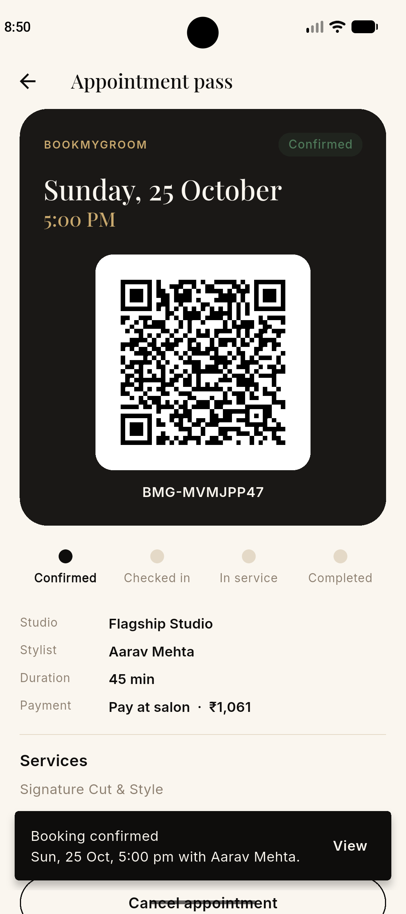

<div align="center">


# BookMyGroom

**Premium unisex salon booking app, built with Flutter and Supabase.**

[](https://flutter.dev)
[](https://supabase.com)
[](#)

</div>

---

## Overview

BookMyGroom lets guests discover services, book a stylist, pay online or at the salon, and check in with a signed QR pass. Studio staff manage the live queue from the same app. All sensitive logic (pricing, conflicts, payments, check-in) runs on the server, never trusting the client.

## Screenshots

| Home | Explore | Booking | Pass |
|---|---|---|---|
|  |  |  |  |

## Features

**Guests**
- Onboarding, email sign up and sign in
- Browse 8 service categories, search, multi-select with live total price and duration
- Service details and stylist profiles with verified ratings
- Booking flow: stylist (or any available), date, time slot
- Checkout with coupons, 18% GST breakdown, pay online (Razorpay) or at the salon
- Signed QR appointment pass with live status (confirmed, checked in, in service, completed) and queue position
- Push notifications for confirmation, check-in, service start, "you're next", reminder one hour before, and review request
- Reviews with separate service and stylist ratings, optional comment and photo
- Loyalty points and tiers
- Upcoming visit card and one-tap "Book again"
- In-app account deletion

**Studio staff**
- QR scanner for check-in (with manual code entry)
- Live "Today's queue" to start and complete services

## Tech stack

| Layer | Choice |
|---|---|
| App | Flutter, Dart, Riverpod, GoRouter |
| Backend | Supabase (Postgres, Auth, Realtime, Storage, Edge Functions, pg_cron, pg_net) |
| Payments | Razorpay (order, signature verification, webhook) |
| Notifications | Firebase Cloud Messaging (HTTP v1) |
| Design | Playfair Display and Inter, ink, ivory and champagne palette |

## Architecture

```
Flutter app ──► Supabase Auth / PostgREST (RLS enforced)
     │                 │
     │                 ├─ RPC: book_appointment, cancel_appointment,
     │                 │       submit_review, set_appointment_status
     │                 └─ Triggers ──► send-push (Edge Function) ──► FCM
     │
     └──► Edge Functions: create-payment-order, verify-payment,
          razorpay-webhook, issue-qr-token, check-in, delete-account
```

Key guarantees:
- **No double booking:** Postgres exclusion constraints per stylist and per user.
- **Server-side pricing:** the app sends service IDs and a coupon code; the database computes totals.
- **Payments:** amounts come from the database; signatures and webhooks are verified server-side.
- **QR check-in:** HMAC-signed tokens, staff-only, single use, time-windowed.
- **Row Level Security** on every table; users only read their own data.

## Project structure

```
lib/
  core/        theme, router, shared widgets, services, utils
  data/        models and mock catalog data
  features/
    auth/ onboarding/ home/ explore/ booking/
    appointments/ reviews/ rewards/ profile/
supabase/
  00x_*.sql    ordered migrations
  functions/   Edge Functions (Deno)
docs/          privacy policy
```

## Getting started

### Prerequisites
Flutter SDK, Android Studio (emulator with Google Play), Node.js, a Supabase project, a Firebase project, a Razorpay account (test mode).

### 1. Clone and install
```bash
git clone https://github.com/shikhar11x/bookmygroom.git
cd bookmygroom
flutter pub get
```

### 2. Configure environment
Create `env.json` in the project root (git-ignored):
```json
{
  "SUPABASE_URL": "https://YOUR-PROJECT.supabase.co",
  "SUPABASE_ANON_KEY": "YOUR-PUBLIC-KEY"
}
```
Never put the service role key or any secret in the app.

### 3. Database
Run the files in `supabase/` in numeric order (001 to 009) in the Supabase SQL Editor. Replace `REPLACE_WITH_PUSH_SECRET` in `007_push.sql` and `008_reminders.sql` with your own secret when running them (do not commit the real value).

### 4. Edge Functions
Create `supabase/.env.secrets` (git-ignored):

| Variable | Purpose |
|---|---|
| `RAZORPAY_KEY_ID`, `RAZORPAY_KEY_SECRET` | Razorpay API |
| `RAZORPAY_WEBHOOK_SECRET` | Webhook signature |
| `QR_SIGNING_SECRET` | QR token signing |
| `PUSH_WEBHOOK_SECRET` | Database to send-push auth |
| `FIREBASE_SA_B64` | Base64 of the Firebase service account JSON |

```bash
npx supabase link --project-ref YOUR_REF
npx supabase secrets set --env-file supabase/.env.secrets
npx supabase functions deploy create-payment-order
npx supabase functions deploy verify-payment
npx supabase functions deploy razorpay-webhook --no-verify-jwt
npx supabase functions deploy issue-qr-token
npx supabase functions deploy check-in
npx supabase functions deploy send-push --no-verify-jwt
npx supabase functions deploy delete-account
```

### 5. Firebase
```bash
flutterfire configure --project=YOUR_FIREBASE_PROJECT --platforms=android --android-package-name=com.bookmygroom.app
```

### 6. Run
```bash
flutter run --dart-define-from-file=env.json
```

### Make an account staff
```sql
insert into public.staff (user_id)
select id from auth.users where email = 'you@example.com';
```

## Testing
```bash
dart format lib test
flutter analyze
flutter test
```

Razorpay test card: `4111 1111 1111 1111`, any future expiry, CVV `123`.

## Release build
Create an upload keystore, add `android/key.properties` (git-ignored), then:
```bash
flutter build appbundle --release --dart-define-from-file=env.json
```

## Security
- Secrets live only in Supabase secrets and git-ignored files.
- Report vulnerabilities privately to [your email].

## Roadmap
- Redeem loyalty points for discounts (server-side)
- Admin panel for catalog, stylists, coupons and review moderation
- Memberships, gift cards and referrals
- Cancellation waitlist
- iOS release

## License
Copyright (c) 2026 [Shikhar / Blazestack]. All rights reserved.